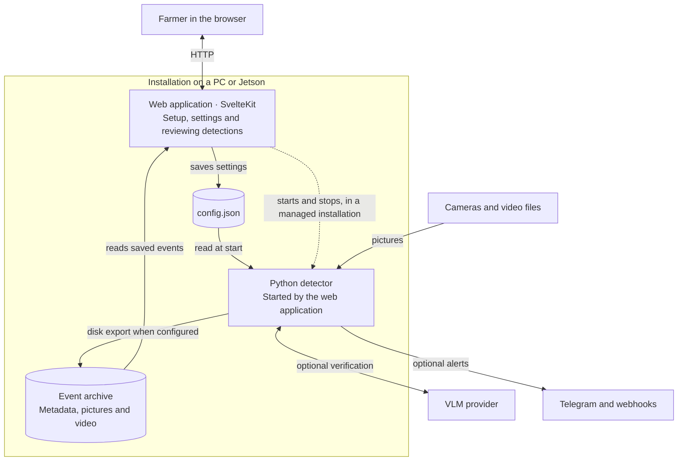
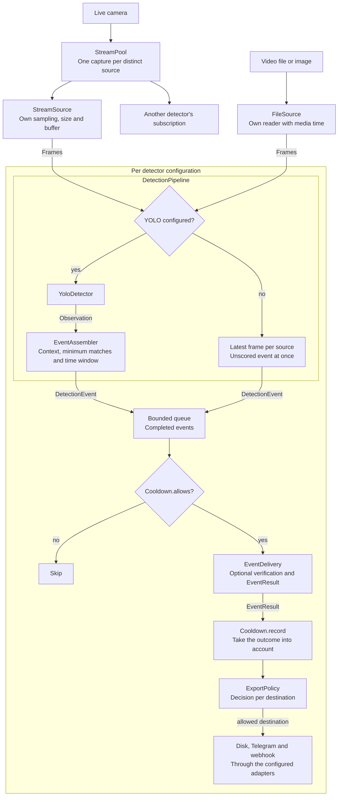
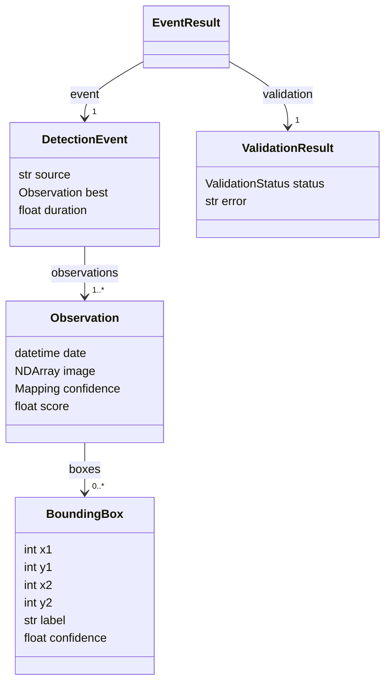
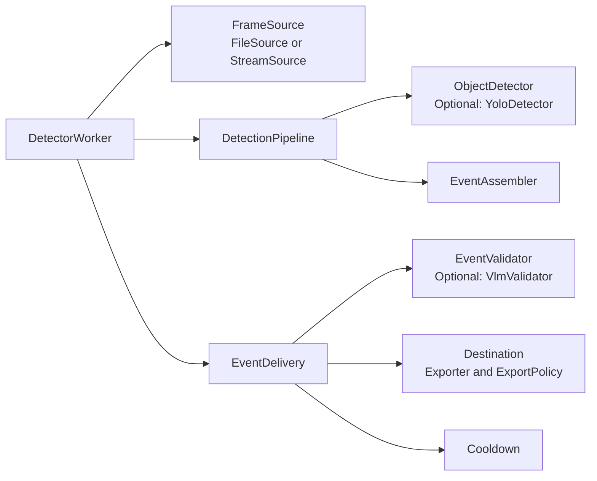

# AI Detector system overview

Read the diagrams from the outside in: first the parts, then how a camera picture becomes an event, the domain model, and how the code is connected. The names in the diagrams are names in the code.

## 1. Which parts work together?

This map follows the [C4 model](https://c4model.com/): start with the user, the running parts and their connections. A C4 container is a running program, such as a web server or the detector process; it need not be a Docker container.

Solid arrows are data; the dotted arrow is process control. The web application reads the event archive straight from the shared data folder. The detector offers no HTTP API: the metadata and media files are the contract between the two.

There are two ways to run these parts:

| Installation | Who starts and stops the detector? | Applying settings |
| --- | --- | --- |
| Complete application download, or the container image | The web application, through `ManagedDetector` | The running detector is restarted when settings are saved. |
| The web server and the detector started separately, as in development | Whoever started the detector | The detector must be restarted after a configuration change. |

Closing a browser tab does not stop processing. Installing and starting automatically are described in the [user guide](README.md).

The map shows the main route. The web application also has its own FFmpeg route for live camera pictures, separate from the camera connections of the Python process. Model downloads, health checks and the web application's own labels are left out to keep the map readable.

## 2. How does a camera picture become an event?

This is the order of processing inside Python. Arrows are data and decisions, not imports between modules.

The detector's architecture guide has the rules behind each step: [resource ownership](detector/ARCHITECTURE.md#resource-ownership) for the shared captures, the two threads and the queue between them; [event rules](detector/ARCHITECTURE.md#event-rules) for when an event starts and closes and which verification outcomes consume the cooldown; [verification and delivery](detector/ARCHITECTURE.md#verification-and-delivery) for what reaches each destination. An event without class scores has no class cooldown.

## 3. What do the main domain objects mean?

This small class diagram shows the relations and a selection of fields and derived properties. It is meant for learning the language of the system.

`BoundingBox.label`, `BoundingBox.confidence` and `ValidationResult.error` are optional. The detector's [vocabulary](detector/ARCHITECTURE.md#vocabulary) says what each term means.

## 4. How are the parts connected in the code?

`run_application` builds one worker per detector configuration, with a source, a pipeline and a delivery. The arrows mean "uses". The pipeline creates its own assembler, with a fixed `EventPolicy`.

The detector's table of [where a change belongs](detector/ARCHITECTURE.md#where-a-change-belongs) names the file and the tests of each part, and [resource ownership](detector/ARCHITECTURE.md#resource-ownership) says what opens the models and closes them at shutdown.

## Reading the code from here

The detector's [reading path](detector/README.md#working-on-it) follows one event through the code, from bootstrap to the archive. Its [architecture guide](detector/ARCHITECTURE.md) has the dependency rules, the exact time rules and the failure handling.

## Keeping this up to date

The diagrams are Mermaid text beside the code, and [GitHub renders them](https://docs.github.com/en/get-started/writing-on-github/working-with-advanced-formatting/creating-diagrams). Update them when a process boundary, a public data exchange, a domain concept or an important processing step changes. Small internal helpers do not belong in the overview.
