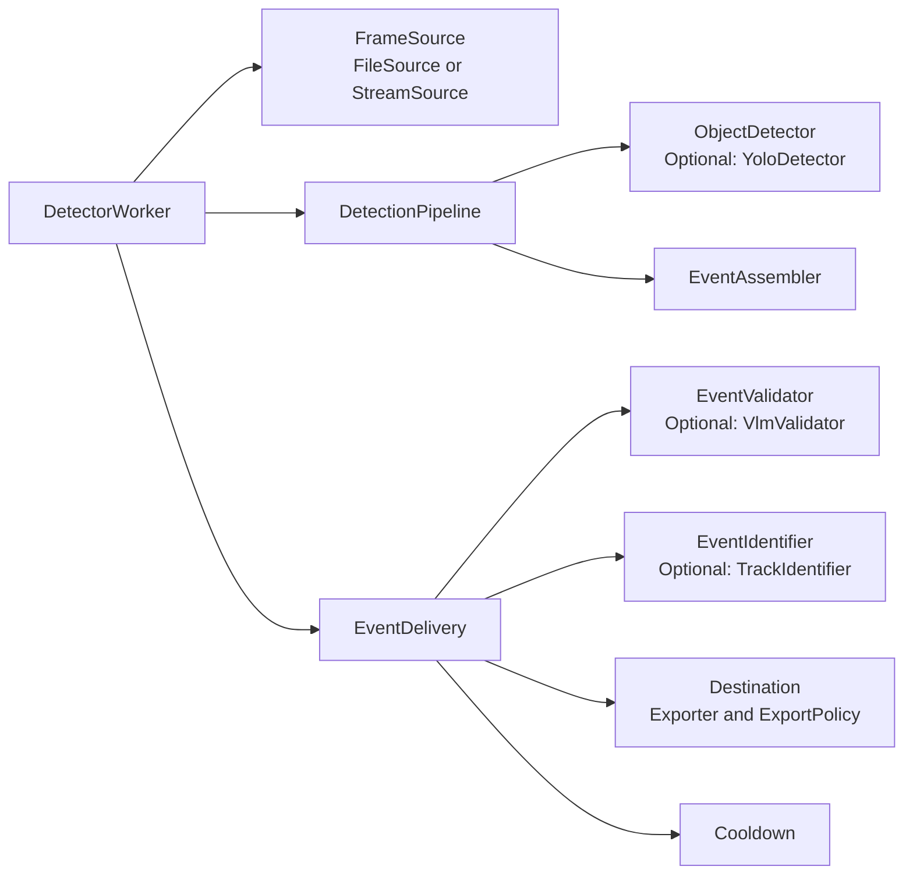
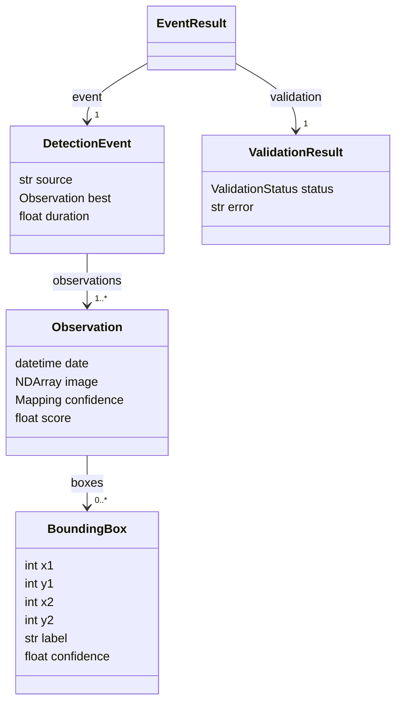
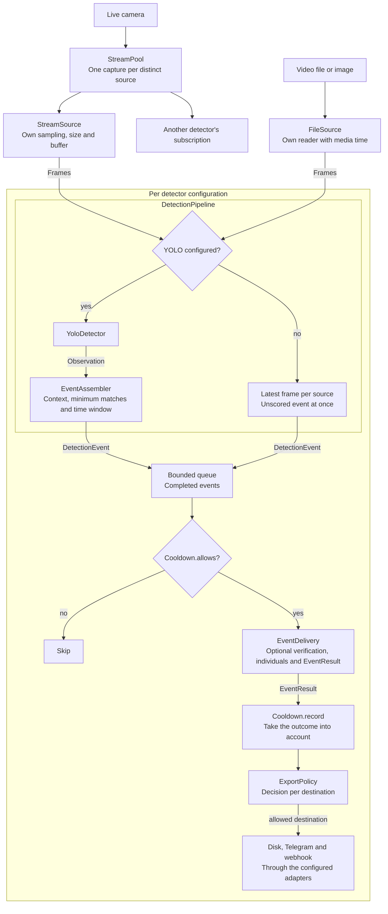

# Detector architecture

The detector watches video sources, groups object observations into events, optionally verifies an event with a vision language model, and archives or delivers the result.

It is a small hexagonal application. Event decisions are isolated from I/O, and dependencies point inward, following the [Clean Architecture dependency rule](https://blog.cleancoder.com/uncle-bob/2012/08/13/the-clean-architecture.html). Application use cases (`DetectionPipeline.process`, `EventDelivery.deliver`) define the ports they need in `application/ports.py`; adapters implement them; bootstrap constructs everything explicitly. There is no injection framework and no interface per class: a protocol exists where there is a real I/O boundary, and event rules are ordinary functions and dataclasses.

## Dependency direction

```text
cli -> bootstrap -> runtime + concrete adapters
                       |
                       v
                  application -> domain
                       ^            ^
                       |            |
                    adapters -------+
```

| Package | Owns |
| --- | --- |
| `domain` | Frozen observation and event records, confidence rules, event windows, cooldown, verification outcomes. No I/O; time comes from the caller. |
| `application` | The order of inference, event assembly, verification and export, through narrow protocols. |
| `adapters` | Video input, YOLO, VLM requests, recognising individuals, image and video encoding, event files, HTTP and Telegram, health pings, platform inference setup. |
| `configuration` | Pydantic input models, normalization, file loading and schema production. Models do not inspect hardware or read files at import. |
| `runtime` | Execution and supervision: one aggregation owner and one ordered delivery worker per detector, plus the optional health monitor. |
| `bootstrap` | Turning validated configuration into policies and concrete integrations, and their cleanup scopes. |
| `cli` | Arguments, logging scope, configuration errors, signals and exit status. Importing it is safe. |

`EventAssembler` and `Cooldown` hold deterministic state, so the domain is not stateless; it still performs no I/O. Image fields are annotated `NDArray[np.uint8]` under `TYPE_CHECKING`: the domain keeps useful types without loading NumPy or touching pixels. That annotation in `domain.models` is the only third-party dependency the core is allowed.

Adapters are grouped by responsibility:

```text
adapters/
├── exporters/     disk, archive_metadata, telegram, webhook
├── sources/       files, streams
├── inference/     model assets, ONNX providers, YOLO, prepared models and engines
├── individuals/   embedding model, sightings, names, grouping and the naming threshold
├── media/         images, video, event attachments
├── health.py      periodic pings, supervised by runtime
├── diagnostics.py log formatting, redaction, rotation, configuration summaries
├── http.py        transport shared by exporters and health
├── live_preview.py, operational_status.py   desktop integration
└── vlm.py         event verification and its connection check
```

Exporters, sources, inference and individuals never import one another, directly or indirectly; bootstrap connects them through application ports. Media and HTTP are shared. Archive metadata sits beside the disk exporter because it defines the public archive format. Package initializers do not re-export their children: import the module that owns an operation.

[`.importlinter`](.importlinter) declares the layers, the forbidden imports, adapter-group independence and acyclic siblings, including imports inside functions and type-checking-only imports. Two test files add what the contracts cannot see. `tests/test_architecture.py` checks that every source file is in the import graph; a folder without `__init__.py` would otherwise escape the rules. `tests/test_import_safety.py` imports the core in a child process and fails if that reads configuration, writes files, opens sockets, starts threads or processes, or loads an inference library. These checks establish structure, not that every responsibility is well placed.

## Where a change belongs

`run_application` builds one worker per detector configuration, with a source, a pipeline and a delivery. The arrows mean "uses"; the pipeline creates its own assembler, with a fixed `EventPolicy`.



Tests mirror the `domain`, `application` and `adapters` packages.

| Change | Implementation | Tests to start with |
| --- | --- | --- |
| Configuration fields or schema | [configuration](src/aidetector/configuration.py), [schema generation](src/aidetector/schema.py) | [configuration](tests/test_configuration.py), [schemas](tests/test_schemas.py) |
| Event timing | [event assembler](src/aidetector/domain/events.py) | [events](tests/domain/test_events.py) |
| Confidence, cooldown, or domain records | [policy](src/aidetector/domain/policy.py), [models](src/aidetector/domain/models.py) | [policy](tests/domain/test_policy.py), [events and records](tests/domain/test_events.py) |
| Inference/verification sequencing or delivery policy | [pipeline](src/aidetector/application/pipeline.py), [delivery](src/aidetector/application/delivery.py), [ports](src/aidetector/application/ports.py) | [pipeline](tests/application/test_pipeline.py), [delivery](tests/application/test_delivery.py) |
| Startup, shutdown, or worker supervision | [CLI](src/aidetector/cli.py), [bootstrap](src/aidetector/bootstrap.py), [runtime](src/aidetector/runtime.py) | [CLI](tests/test_cli.py), [runtime](tests/test_runtime.py) |
| Managed process recovery | [CLI exit codes](src/aidetector/cli.py), [process manager](../web/src/lib/server/managed-detector.ts) | [CLI](tests/test_cli.py), [process recovery](../web/tests/runtime-recovery.test.ts) |
| Support logs, safe configuration summaries, or log retention | [diagnostics](src/aidetector/adapters/diagnostics.py) | [diagnostics](tests/adapters/test_diagnostics.py), [CLI](tests/test_cli.py), [runtime](tests/test_runtime.py) |
| Launcher readiness and camera health | [status contract](src/aidetector/application/ports.py), [JSON status writer](src/aidetector/adapters/operational_status.py) | [status protocol](tests/adapters/test_operational_status.py), [CLI integration](tests/test_cli.py), [shared capture](tests/adapters/sources/test_shared_streams.py) |
| Live analyzed pictures | [protocol](#live-analyzed-pictures), [live preview adapter](src/aidetector/adapters/live_preview.py), [pipeline](src/aidetector/application/pipeline.py) | [publisher lifecycle](tests/adapters/test_live_preview.py), [pipeline observations](tests/application/test_pipeline.py), [web bridge](../web/tests/live-preview.test.ts) |
| Camera sharing or file sampling | [streams](src/aidetector/adapters/sources/streams.py), [files](src/aidetector/adapters/sources/files.py) | [shared streams](tests/adapters/sources/test_shared_streams.py), [sources and file sampling](tests/adapters/sources/test_sources.py) |
| YOLO, model assets, or ONNX providers | [inference adapters](src/aidetector/adapters/inference/) | [YOLO and SDK lifetime](tests/adapters/inference/test_yolo.py), [ONNX](tests/adapters/inference/test_onnx.py), [model assets](tests/adapters/inference/test_model_assets.py), [model loading](tests/adapters/inference/test_model_loading.py) |
| Inference timing logs | [YOLO adapter](src/aidetector/adapters/inference/yolo.py), [streams](src/aidetector/adapters/sources/streams.py), [measurement guide](PERFORMANCE.md) | [timing summary](tests/adapters/inference/test_yolo.py), [shared resize](tests/adapters/sources/test_shared_streams.py) |
| Windows ML startup or provider downloads | [Windows ML helper](src/aidetector/adapters/inference/windows_ml.py), [native startup probe](src/aidetector/adapters/inference/provider_probe.py), [ONNX registration](src/aidetector/adapters/inference/onnx.py) | [process isolation and timeouts](tests/adapters/inference/test_windows_ml.py), [probe inference, exits and timeouts](tests/adapters/inference/test_provider_probe.py), [provider selection and lifetime](tests/adapters/inference/test_onnx.py) |
| Downloaded Windows CUDA runtime | [distribution staging](../distribution/nvidia_runtime.py), [desktop preparation](../web/src/lib/server/nvidia-runtime.ts) | [payload and dependency checks](../distribution/test_nvidia_runtime.py), [process lifecycle](../web/tests/nvidia-runtime.test.ts), [Windows package installation](../web/tests/nvidia-runtime-installed.test.ts) |
| Model conversion or prepared cache | [export settings](src/aidetector/adapters/inference/export_settings.py), [prepared models](src/aidetector/adapters/inference/prepared_models.py) | [conversion/cache contracts](tests/adapters/inference/test_prepared_models.py), [model loading](tests/adapters/inference/test_model_loading.py), [real SDK export](tests/integration/test_model_export.py) |
| Automatic direct TensorRT | [GPU engine cache and background preparation](src/aidetector/adapters/inference/prepared_engines.py), [export worker](src/aidetector/adapters/inference/tensorrt_worker.py), [desktop preparation](../web/src/lib/server/nvidia-runtime.ts) | [preparation, concurrent monitoring, cancellation and fallback](tests/adapters/inference/test_prepared_engines.py), [runtime installation](../web/tests/nvidia-runtime.test.ts), [planned restart and shutdown](../web/tests/runtime-recovery.test.ts) |
| Cropping, annotations, or encoded media | [media adapters](src/aidetector/adapters/media/) | [media](tests/adapters/media/test_media.py) |
| Recognising individuals, sightings, grouping or the naming threshold | [individuals adapters](src/aidetector/adapters/individuals/), [delivery](src/aidetector/application/delivery.py) | [herd and sightings](tests/adapters/individuals/test_herd.py), [scoring](tests/adapters/individuals/test_scoring.py), [grouping](tests/adapters/individuals/test_grouping.py), [delivery](tests/application/test_delivery.py), [CLI wiring](tests/test_cli.py) |
| VLM responses, fallback or connection check | [VLM adapter](src/aidetector/adapters/vlm.py) | [VLM validation and connection check](tests/adapters/test_vlm.py) |
| Archive format or publication | [disk](src/aidetector/adapters/exporters/disk.py), [metadata](src/aidetector/adapters/exporters/archive_metadata.py) | [disk](tests/adapters/exporters/test_disk.py), [reference flow](tests/test_reference_flow.py), [schemas](tests/test_schemas.py) |
| Telegram, webhooks, or health requests | [Telegram](src/aidetector/adapters/exporters/telegram.py), [webhook](src/aidetector/adapters/exporters/webhook.py), [health](src/aidetector/adapters/health.py) | [exporters and HTTP](tests/adapters/exporters/test_exporters.py), [health](tests/adapters/test_health.py) |

## Vocabulary

The detector has one model: turn footage from a source into a completed event, obtain its verification outcome, and apply cooldown and export policies. Domain, application and adapters are layers of that one model, not separate bounded contexts. There is no repository, aggregate base class or event bus, because nothing here needs one.

| Term | Meaning |
| --- | --- |
| Source | The configured identity of a camera, stream or file. Event windows and cooldowns are kept per source. |
| `Frame` | An acquired image and its source timestamp, before inference. |
| `Observation` | A frame with matching class scores and optional display boxes. It may be an unscored context frame. |
| Qualifying observation | An observation with a nonempty confidence map after class thresholds. Only these count toward `frames_min`. |
| `BoundingBox` | Image coordinates with an optional label, score and tracker ID. A cropped image is a media result, produced by an adapter. |
| Event window | The assembler's mutable, per-source collection while an event is active. |
| `DetectionEvent` | A completed, nonempty sequence of observations from one source in source-time order. Its best observation has the highest score; ties keep the first. |
| `ValidationResult` | Approved, rejected, unvalidated (no verifier) or failed (verifiers could not answer). |
| `EventResult` | An event, its verification outcome, its ID and, when individuals are recognised, its `Identification`. Delivery outcomes belong to the application's `DeliveryReport`. |
| Sighting | One track's best pictures from one event, kept so a person can name them. |
| `Individual` | A tracked object of an event with the named individuals it resembles most; recognised when the best clears the installation's own threshold. |
| Cooldown | The interval since an accepted event's best observation, per source and class within one detector. |

How the main records relate, with a selection of their fields:



Producers establish invariants once and consumers rely on them: sources and inference supply nonempty, ordered batches; images are `uint8` H×W×3 in BGR order; frozen records borrow arrays and score maps as read-only values. Consumers do not re-validate or copy.

The archive is a public projection for the web application. `EventMetadata` keeps its field names (`detections` is the number of observations including context; `crop` is the best observation's enclosing box) so that internal names can improve without migrating archives.

## Event rules

The order of processing inside one run. Arrows are data and decisions, not imports between modules; an event without class scores has no class cooldown.



- An event begins with a qualifying observation and may include context that preceded it in the same batch. Boxes alone do not make a frame qualify.
- It closes at its maximum duration, after its inactivity timeout, at EOF, or when shutdown drains the detector. Trailing frames are kept only within the configured trailing time after the last qualifying observation.
- Buffered observations are consumed in timestamp order. Eligible trailing frames before a boundary stay with the closing event; the observation at the boundary starts the next window.
- State never crosses sources. Finite files use media time, so grouping does not depend on machine speed, and each file's EOF closes its own event. Live sources use capture time. `SourceBatch.advance_to` lets an idle live source expire its window; finite sources omit it.
- Without a YOLO model the pipeline emits one unscored event per source batch, holding its latest frame.
- Cooldown is checked before verification, on the delivery worker, so two events cannot both pass. At least one class of the best observation must be outside its cooldown. Approved and deliberately unvalidated results consume it for every class of that observation; rejection and failed verification do not.
- Consuming cooldown, a destination's eligibility and a successful delivery are three separate decisions. A failed exporter does not undo acceptance, which keeps the alert cadence when a destination is down.

## Verification and delivery

The four verification outcomes stay distinct everywhere. A configured verifier that fails must never turn into an ordinary unvalidated notification; disk may archive such an event under `unvalidated` with the error recorded. The disk adapter, not the domain, maps outcomes onto the public `approved`, `rejected` and `unvalidated` folders.

A verifier entry runs only when its `key` is not null; a non-null key requires a model. Python reads everything from `config.json` and never resolves the web application's shared connections: the web copies a connection into the detector's `vlm` settings when it saves. An explicitly empty key means an unauthenticated service and prevents environment-key lookup.

Fallback is finite and specific. Provider errors and invalid answers move to the next model; a media encoding failure skips that verifier entry so another strategy can run; exhausting all entries is failed verification. A valid negative answer is final. An unexpected `IndexError` or `ValueError` from the SDK reaches supervision rather than being reported as an unavailable verifier. The answer model has one Boolean field, `detected`, and is both the schema sent to the provider and the validator of its reply.

`EventDelivery` applies each destination's `ExportPolicy` before calling its exporter, so calling an adapter directly would bypass confidence and rejection filtering. Destinations are attempted independently. Expected failures are recorded; an unexpected one stops the worker after the others have been attempted.

Media is encoded once per requested variant and shared between destinations; the cache weakly references its event and is dropped with it. Video is written incrementally to temporary input rather than held as a second clip in memory. Disk events get unique directories and become visible only when media and metadata are complete. Raw pixels are never modified by overlays.

## Individuals

`individuals` in `config.json` names an ONNX embedding model and the classes whose tracked objects are individuals, such as cows. It is off without it, and it needs at least one detector with `yolo.tracking`, because an individual is named per track, not per picture. Nothing about a species is built in: the model and the classes come from the configuration.

- **Model.** A bring-your-own file or URL, downloaded into `models/` like a YOLO URL. It takes float32 RGB pictures as N×3×H×W with a fixed height and width and returns one embedding per picture; its ONNX metadata may set `mean` and `std` (three values on the 0 to 1 scale), and ImageNet's apply otherwise. It joins the YOLO models when execution providers are prepared, so it runs on the same hardware, through the same session factory.
- **When.** Delivery asks the `EventIdentifier` port after verification and before the destinations, on the delivery thread, so a slow embedding delays the alert, never detection. Rejected events are not identified. An expected failure (an unreadable `names.json`, a sighting that cannot be saved) is `IdentificationUnavailable`: the event is still delivered, with the error in `individuals_error` instead of names.
- **Sightings.** For each track of a configured class, `TrackIdentifier` takes up to four pictures: whole boxes away from the frame's edge and not largely covered by another box come first, largest first and spread over the event; others only make up the number, and boxes under 48 pixels are skipped. The first event a track appears in saves them as a sighting; later events reuse it. Tracker IDs belong to one detector's tracking run, so each detector has its own `TrackIdentifier`.
- **One herd.** `Herd` is shared by every detector and camera of a run. It reads `names.json` again when its size or modification time changes, so names given while monitoring apply to the next event, and a lock keeps that reload to one delivery thread at a time.
- **Scores.** A sighting's score for an individual is the mean similarity of the individual's two most similar named pictures to each of the sighting's pictures, averaged over those pictures, less three quarters of the runner-up's score. The three best are the candidates.
- **Threshold.** The installation sets it from its own named sightings: each day's sightings are asked in turn against the other days', with a quarter of the individuals withheld as strangers in three draws, and the threshold is the lowest score whose names are right at least `precision` (0.99) of the time over all answers pooled. Until two days have names there is no threshold: candidates are suggestions and nobody is recognised.
- **Grouping.** After an event saves a new sighting, the latest 1000 unnamed sightings are grouped by look (average linkage of their mean embeddings, cut at a similarity of 0.6) and written to `groups.json`, largest group first, each with the three named individuals it resembles most. A person names a whole group at once instead of each sighting.

The folder is shared with the web application, which writes `names.json`; the detector writes each sighting once, afterwards only adds embeddings for another model, and replaces `groups.json` whole.

```text
DATA_DIR/individuals/
├── names.json                  {"version": 1, "names": {"<sighting ID>": "412"}}
├── groups.json                 version, model key, groups of sighting IDs with suggested names
└── sightings/<sighting ID>/
    ├── sighting.json           version, id, camera, label, track, seen, event_id, crops
    ├── crop-1.jpg …            at most 512 pixels on the longest side
    └── vectors-<model key>.npy embeddings, per model file
```

A model key is the start of the model file's SHA-256. After the model changes, a named sighting without embeddings for the new key is embedded again from its pictures, so names survive a change of model.

## Configuration boundary

`config.json` accepts a single value or a list for sources, verifiers and exporters, and the boundary normalizes them once. Reading or checking configuration never rewrites the file. Defaults are deterministic and do not depend on hardware.

Configuration owns source syntax and the finite-or-live distinction through a pure classifier; file existence and camera availability are runtime concerns. URLs for sources, webhooks and health use strict Pydantic validation and keep the validated string as written, including credentials. Disk categories are single directory names, enforced by the same constraint in Python and in the generated schema, which preserves the `detections/<category>/<stage>/<timestamp>/` layout the web reader depends on. Secrets are excluded from reprs and logs.

## Resource ownership

- **Runtime** owns the workers and their stop signal. Each detector has a processing thread (inference and event assembly) and a delivery thread (cooldown, verification, exports) joined by a bounded queue, which applies backpressure instead of retaining image sequences. Workers release a completed event before blocking for more work.
- **Bootstrap** owns one `StreamPool` per run. Every live subscription is registered before any capture opens; there is one capture thread per distinct source string. The pool closes before model teardown, also when startup fails part-way.
- **A `StreamSource`** is one detector's subscription, with its own sampling interval, width and bounded unread buffer. Subscribers that want the same width share one resized frame. A slow detector drops its own oldest frames; it cannot block acquisition or consume another detector's frames. Sharing is by exact source string within one process. File readers stay independent because they advance with each detector's media time.
- **Inference**: bootstrap enters `inference_runtime` once per run and `open_detector` once per YOLO model. Each context releases what it opened, including after a failure during startup. A detector's YOLO adapter owns its tracking state.
- **Health**: the adapter performs timed requests behind the `HealthMonitor` port and starts no thread of its own. Runtime runs it beside the workers and stops it when the last finite detector ends.

Shutdown attempts every registered stop before joining, so one failed stop cannot block the others, and each worker logs its own unexpected failure before it propagates. Expected live-source failures reconnect with an interruptible delay; invalid configuration and programming errors do not loop.

## Inference backends

Backend selection lives in the inference adapters; the domain and application never see it. The [individuals model](#individuals) is an ONNX model like any other here, so it alone also selects ONNX execution providers when every YOLO model is a checkpoint.

- **macOS**: without a configured ONNX provider, `.pt` checkpoints are exported once to Core ML, which the SDK runs on the processor and the Neural Engine. The model is FP16 with a fixed square `imgsz` input, and the SDK passes a batch to Core ML as separate pictures.
- **Prepared ONNX and Core ML models** (`prepared_models.py`): a `.pt` checkpoint is exported once into `models/prepared/`, keyed by checkpoint contents, task, export settings and library versions, and published atomically. ONNX exports are checked first. The original checkpoint is never modified, and a failed export publishes nothing.
- **Windows NVIDIA**: the web application's process manager prepares a separate CUDA Python environment and starts the same CLI in it (see [distribution](../distribution/README.md#windows-nvidia-runtime)). On compute capability 8.0+ it adds `--prefer-tensorrt`.
- **Jetson container**: the ARM64 image starts the CLI with `--prefer-tensorrt` too. Without a CUDA device the preference is dropped with a warning and detection runs on the processor.
- **TensorRT engines** (`prepared_engines.py`, `tensorrt_worker.py`): monitoring starts with a cached engine or with CUDA, and missing engines are built one at a time in the background by a short-lived helper process. The engine key includes checkpoint, settings, GPU, driver and runtime versions. When the queue finishes with at least one new engine, one `models_ready` status record asks the desktop to restart monitoring once. Predictors are never swapped in a running process. Only this automatic optimization may fall back to CUDA; an engine the user supplied may not.
  - A failed build, one past its thirty-minute deadline, or one cut off by a crash leaves CUDA running and is tried again at a monitoring start at least 24 hours later. No timer retries it while monitoring runs. Pause and quit cancel a build without that delay.
  - Each attempt keeps `models/prepared/tensorrt/<identity>/build.log`; `failure.txt` beside it holds the reason.
  - The builder's 2 GiB workspace is scratch space, not a limit on GPU memory: weights and the running detectors come on top, and a build slows inference while it runs.
- **Windows ML** (`windows_ml.py`): provider discovery and preparation run in a short-lived helper process, which keeps PyWinRT out of the inference process (a [documented conflict](https://ryzenai.docs.amd.com/en/latest/winml/troubleshooting.html) with TensorRT RTX registration). The helper has a 150-second deadline and resolves package-relative DLL names to existing absolute paths before its Windows package dependency graph closes. The inference process keeps each provider's DLL directory available until that provider is unregistered. Automatic selection prefers vendor GPUs, then built-in DirectML, then experimental WebGPU, then CPU devices. It skips unavailable downloaded providers while retaining built-in acceleration; CPU fallback carries a notice. An explicitly requested provider stays a visible failure. Before automatic selection includes built-in DirectML, a separate process runs a tiny matrix multiplication through the same provider/device API. A native crash, incorrect result or thirty-second timeout removes it from automatic selection with a notice; an explicit DirectML request fails visibly. This probe imports no PyWinRT. DirectML sessions disable memory patterns and parallel execution as its runtime requires. Startup logs list built-in and selected providers separately.

## Desktop integration

The web application starts the detector and talks to it through four optional, separate channels. None of them reaches the domain.

- `--control-stdin`: a line `stop`, or EOF on the parent's pipe, requests the normal stop-and-drain path on every OS. Ordinary runs do not read stdin.
- `--status-json`: versioned records on stdout, prefixed `AIDETECTOR_STATUS `, carrying an event kind, a UTC time, a SHA-256 source key and the run-local identities of the rule (`detector-N`) and the destination (`disk-N`, `telegram-N`, `webhook-N`). They contain no camera address. `application/ports.py` defines the kinds and the source key; `adapters/operational_status.py` writes them, limiting the frequent ones (frames, inference, processing, offline, waiting for delivery) to one per source and rule per second. The web application derives readiness from these records and their freshness, never from log text or from the process having started.
- `--live-preview`: the size and boxes of the latest analyzed picture per rule, published only while someone is watching; see [live analyzed pictures](#live-analyzed-pictures).
- Reviews: the delivery use case gives each `EventResult` a UUID shared by all destinations. Disk stores it as `event_id`; Telegram puts it in the review buttons. Receiving reviews and writing them into `metadata.json` belongs to the web application.

Managed monitoring is continuous: the web application restarts the detector after any unexpected exit. A standalone CLI run finishes at EOF and reports its exit status.

Logs are for people and are a separate concern: the diagnostics adapter writes the console and a rotating `logs/detector.log`, redacts credentials in messages and tracebacks, and names cameras by the first 12 characters of the same source key.

### Live analyzed pictures

`--live-preview` is a file transport in the data folder shared with the web application. Managed launches enable it; a standalone run must opt in and share that folder. It creates no HTTP server and opens no extra camera connection. It assumes one detector publisher and one web process per data folder, as in managed installations and the supplied Compose files, and it is an operational view, not a recording or proof that recording and alerts succeeded.

`DetectionPipeline` calls its `PublishObservation` callback after successful inference and before event assembly, with the latest analyzed observation; snapshot rules publish theirs with empty boxes. Publishing creates no event, changes no score and does not depend on recording or notification thresholds. Track IDs are optional, scoped to one tracking run, and identify nothing. The adapter owns one thread: the callback only replaces the pending observation of a source and rule while a viewer is active, and the thread writes at most eight times per second per pair, so a slow disk can neither block inference nor collect a frame history. It writes the size of the analyzed picture and its boxes, never pixels: the web application shows its own camera pictures.

Version 1 files are under `DATA_DIR/live`. They name a source by its source key, never by its address or credentials.

- `session.json`: `{version: 1, runId, updatedAt}`, with a unique ID per process run. The publisher replaces this heartbeat once per second and removes it on orderly shutdown.
- `leases/<sourceKey>.json`: `{version: 1, expiresAt}`, in Unix seconds. The web process shares one lease between the viewers of a source, renews it every three seconds and removes it when the last viewer leaves; after a web crash it expires within twelve seconds. The detector ignores invalid or expired leases.
- `frames/<sourceKey>.detector-<ordinal>.json`: `{version: 1, runId, sourceKey, ruleId, publishedAt, image, boxes}`. `image` is `{width, height}`, the analyzed picture's size in pixels; a box has pixel coordinates `x1, y1, x2, y2`, a nullable `label`, `confidence` and `trackId`. Each record is written to a temporary sibling and atomically replaced, so size and boxes stay coherent.

Each rule and source pair keeps one record. A starting publisher removes the previous run's records and its known temporary files. A failed preview write is logged apart from event processing and does not stop other rules from publishing.

The web server accepts a frame only from the current session and for the matching source and rule. A session is unavailable after six seconds without a heartbeat, and a frame after the larger of fifteen seconds or three inference intervals plus five seconds, counted from publication because file footage may carry historical timestamps. `GET /cameras/live?camera=<camera-id>`, with the parameter repeated per camera, streams same-origin server-sent events over one connection for all visible cameras ([shared contracts](../web/src/lib/live-preview.ts)):

- `frame`: the version 1 record with the camera ID, the rule's current label and optional preset. Boxes scale from the record's image size onto the independently playing video, letterboxing included, so a moving object can leave its box between inferences.
- `status`: a camera and rule without a current result, whose boxes are cleared; `{}` clears every box when the stream fails. An empty detection result also clears that rule's boxes.
- `heartbeat`: `{}` when nothing changed, so the browser can tell an unchanged result from a stalled connection.

A changed run ID closes the stream, so a reconnection resolves current settings and labels. A slow consumer skips intermediate records instead of queuing them.
