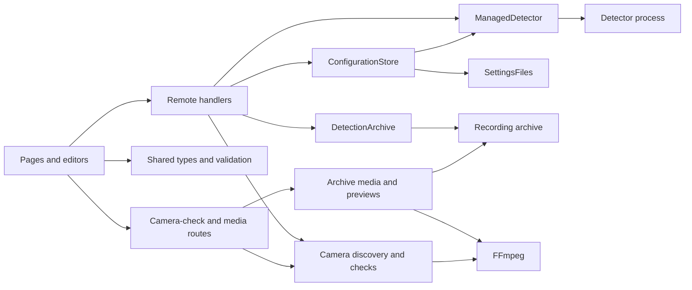

# Web application architecture

A page calls a remote handler; the handler validates the request and calls a concrete server service; the service owns files or a process. Components do not know where files live or how a process is started.

The three pages people use every day are `routes/(admin)/detections` (Recordings), `streams` (Cameras) and `detectors`. `/setup` is first-run guidance only: it renders the same `camera-add.svelte` and `detector-editor.svelte` components in three steps and ends by starting monitoring.



There are no domain, use-case or port folders here, because this application mostly coordinates files and processes. Concrete services and small shared models express its boundaries; the event rules live in the detector.

## Where a change belongs

Paths are relative to `src/` for code and `tests/` for tests.

| Concern                                           | Read first                                                                                         | Tests                                                                   |
| ------------------------------------------------- | -------------------------------------------------------------------------------------------------- | ----------------------------------------------------------------------- |
| Request and settings validation                   | `lib/configuration.ts`, `lib/schema.ts`                                                            | `configuration.test.ts`                                                 |
| Settings use cases and their order                | `lib/server/configuration/store.ts`                                                                | `configuration.test.ts`                                                 |
| Camera, detector, alert and connection edit rules | `lib/server/configuration/cameras.ts`, `detectors.ts`, `telegrams.ts`, `llms.ts`                   | `configuration.test.ts`, `camera-configuration.test.ts`, `llm.test.ts`  |
| Settings files, recovery snapshot, paired devices | `lib/server/configuration/settings-files.ts`                                                       | `configuration.test.ts`, `device-access.test.ts`                        |
| Starting, stopping and restarting the detector    | `lib/server/managed-detector.ts`, `detector-preparation.ts`, `nvidia-runtime.ts`                   | `runtime.test.ts`, `runtime-recovery.test.ts`, `nvidia-runtime.test.ts` |
| What counts as monitoring                         | `lib/server/runtime-status.ts`, `lib/monitoring.ts`                                                | `runtime-status.test.ts`, `monitoring.test.ts`                          |
| Telling people a camera is not watched            | `lib/server/outage-alerts.ts`, `detector-service.ts`                                               | `outage-alerts.test.ts`                                                 |
| Recordings, reviews and playback                  | `lib/server/archive.ts`, `file-media.ts`, `lib/detections.ts`                                      | `archive.test.ts`                                                       |
| Exports, backups and diagnostics                  | `lib/server/recording-export.ts`, `settings-backup.ts`, `diagnostics.ts`, `zip-download.ts`        | `exports.test.ts`, `diagnostics.test.ts`                                |
| Camera discovery, connection and test recording   | `lib/server/cameras/`, `lib/cameras.ts`, `lib/camera-batch.ts`                                     | `cameras.test.ts`                                                       |
| Camera pictures                                   | `lib/camera-pictures.ts`, `lib/server/camera-pictures.ts`, `preview-pool.ts`, `stream-preview.ts`  | `camera-pictures.test.ts`, `preview.test.ts`                            |
| Detection boxes over pictures                     | `lib/server/live-preview.ts`, `source-key.ts`, `lib/camera-pictures.ts`                            | `live-preview.test.ts`, `camera-pictures.test.ts`                       |
| Detector editor and its draft                     | `lib/detector-editor.ts`, `lib/detector-draft-storage.ts`, `lib/components/detector-editor.svelte` | `detector-editor.test.ts`, `detector-draft-storage.test.ts`             |
| Setup checks and completion                       | `lib/server/configuration/camera-setup.ts`, `lib/hooks/setup-verifier.svelte.ts`                   | `camera-setup.test.ts`                                                  |
| Telegram pairing and reviews                      | `lib/server/telegram*.ts`                                                                          | `telegram-pairing.test.ts`, `telegram-reviews.test.ts`                  |
| Importing an earlier installation                 | `lib/server/installation-import/`                                                                  | `installation-import.test.ts`                                           |
| Access from other devices                         | `lib/server/access.ts`, `device-access.ts`, `hooks.server.ts`                                      | `device-access.test.ts`                                                 |
| Storage cleanup                                   | `lib/server/storage.ts`                                                                            | `storage.test.ts`                                                       |
| Navigation, look and wording                      | `lib/navigation.ts`, `lib/components/app-shell.svelte`, `routes/layout.css`, `lib/format.ts`       | `format.test.ts`                                                        |
| Languages                                         | `lib/locales.ts`, `lib/server/request-language.ts`, `locales/`                                     | `language.test.ts`                                                      |
| Desktop process and network discovery             | `../desktop/`                                                                                      | `../desktop/*.test.ts`                                                  |
| Dependency direction                              | `../.dependency-cruiser.cjs`                                                                       | `architecture.test.ts`                                                  |

Services take their dependencies as constructor arguments and are tested with Node's test runner. The few singletons are composed in small files: `configuration/index.ts`, `detector-service.ts`, `recordings.ts`, `access.ts`, `telegram-service.ts`. There is no container.

`pnpm test` runs source behavior, `pnpm test:desktop` the desktop host and `pnpm test:production` the built server over HTTP (`tests/production/`). `pnpm test:e2e` (`tests/e2e/`) drives the built server in Chrome with the real detector: setup, a camera played over RTSP by mediamtx, Cow Catcher, two Telegram recipients, and the alerts the detector sends for a real mounting. It needs Google Chrome, the detector installed in `detector/.venv` (`uv sync --extra default`) and [mediamtx](https://github.com/bluenviron/mediamtx) on the `PATH`, which plays `example/sprong24.mp4` as the camera. Telegram is a stand-in behind a local HTTPS proxy with a test certificate authority, so neither the application nor the detector contacts Telegram; other sites, such as the model download, pass through.

## Rules

**Shared models.** `lib/generated/` holds TypeScript declarations generated from the Python-owned JSON schemas. `lib/schema.ts` derives the web's list forms and its own metadata types; `lib/configuration.ts` validates detector settings with Ajv against the Python schema. The web never maintains a second detector schema.

**Remote handlers** own request validation, redirects and turning expected errors into a 400 (`configurationAction`). They call server services, never other handlers.

**Settings.** `ConfigurationStore` runs one settings operation at a time: read, change, check with the detector, save, apply to the running detector. The edit modules (`cameras.ts`, `detectors.ts`, `telegrams.ts`, `llms.ts`, `advanced.ts`, `camera-setup.ts`) are plain functions on the in-memory document; they load nothing and start nothing. `SettingsFiles` owns the files. Callers go through the store, so every edit stays inside that one sequence.

**`config.json` belongs to the detector, `app.json` to the web.** `app.json` holds names, camera identities, setup progress, saved recipients and AI connections; saving copies a connection's credentials into the detector settings that use it, so Python never reads `app.json`. `app.json` also holds things that stay with the installation and are never exported or recovered: paired devices, and three notes about the installation: `monitoring`, that monitoring should resume at start, `outages`, the cameras people were warned about and since when, and `port`, where the desktop dashboard moved when another program had its port. The store's documents never contain those notes; `installation-notes.ts` reads and writes the first two and gives every writer of the file one short lock, and the desktop runtime writes `port` before the server starts.

**The detector process.** `ManagedDetector` is the only owner of the child process and serializes start, stop, apply and restart. Stopping saves the paused choice before draining, so a crash while draining cannot re-enable monitoring. While monitoring is enabled every unexpected exit is retried, after 2, 4, 8, 16 and then 30 seconds, without a limit; ten minutes of running resets the delay; pause and quit cancel it. From the fifth failure in a row the status carries the reason in `failing`, until a detector reports that it is ready or someone starts monitoring by hand; the summary then shows every step of the next attempt as a problem instead of a start. Ten minutes of running count for the delay however the process ended, so a restart for new settings is not a failure in a row. A watchdog restarts a detector whose cameras deliver frames while nothing is processed for two minutes or longer, and a ready detector that sends no status record at all for a minute, with a grace period after the computer wakes. Browser polling only observes; it never creates or restarts a process. `DetectorPreparation` owns the short-lived checks and the command line; `nvidia-runtime.ts` prepares the CUDA environment on Windows.

**Readiness comes from the detector's status records** (`runtime-status.ts`), never from log text or from the process having started. Every rule of a camera must report completed processing on fresh frames. A recording or delivery failure stays attached to its own destination.

**Logs.** `logs.ts` keeps the start and the latest part of a transcript, redacted, and writes it at most once a second: the current monitoring attempt's, and through `web-log.ts` the server's warnings and errors. The diagnostics download does not load the settings store, so it works with broken settings.

**Cameras.** Discovery uses the ONVIF SDK; FFmpeg records and decodes a short clip as the real check. Checks are temporary, bounded and addressed by opaque IDs; credentials never appear in a URL. A camera request only adds a view-only camera or changes an existing one, keeping its ID, rules and alerts. Detectors are created only in the detector editor.

**Pictures.** `PreviewPool` runs one FFmpeg capture per source for all viewers and keeps only each viewer's newest picture, so a slow browser cannot hold up capture. A capture stays for twenty seconds after its last viewer left, because a new one has to wait for the camera's next keyframe. All live pictures of a page travel over one connection (`/cameras/pictures`), as records of a camera id and a JPEG file: without HTTPS a browser allows about six connections to an address, and a connection per camera would leave none for the rest of the page. Detection boxes come from the detector's [latest-frame files](../detector/ARCHITECTURE.md#live-analyzed-pictures), not from a second camera connection. `source-key.ts` derives the detector's key for a source, once, for both boxes and status.

**Recordings.** `metadata.json` is the only file describing a recording. The detector publishes it once; the web replaces it atomically to add, change or remove `review`, and nothing else. The reviewed result decides where a recording is shown and exported, while media paths keep using the folder it is stored in. Reads confine paths and links to the archive. A damaged recording is skipped with a warning and the rest stay available; a review that is present but invalid is never overwritten. Telegram reviews name an event ID, never a path, and are accepted only from a connected bot and chat.

**Exports and backups** stream through `zip-download.ts` with bounded buffers and cancellation; the browser's download manager receives them.

**Telegram.** One consumer per bot token: `telegram-service.ts` polls for reviews while the server runs, and pairing reserves the bot for its five-minute session. `telegram-inbox.ts` remembers how far each bot was read only while the server runs; Telegram keeps that position itself and delivers again only what was never confirmed. After saving a review, `telegram-reviews.ts` redraws the buttons of the pressed alert with the choice coloured; their format is the one the detector sends in `adapters/exporters/telegram.py`. Neither holds the settings queue.

**Access.** `authorizeRequest` runs before every dynamic route, remote command and media request. The dashboard on this computer is trusted when the peer and the URL host are both loopback and the request is not cross-site; that decision is recorded in `locals.deviceId` and asked for with `isLocalDashboard`. Other browsers pair with a one-use code and receive a revocable cookie; only its hash is stored. Reading the paired devices looks at no other setting and does not wait for the settings queue, so access and recovery keep working with broken settings or a slow detector.

**Import** copies into a staging folder outside the settings queue, then publishes folders and settings in one queued step that refuses an existing setup. A manifest lets a restart finish an interrupted import; a damaged manifest is discarded with its staged copies.

**Presets** behave as the [configuration guide](../config/README.md#presets) describes; the code is in `lib/server/configuration/`. `preset-files.ts` reads a preset folder or the bundled files, which Vite embeds, and names presets and their modes from the file names (`readPresetChoices`, `presetFile`). `presets.ts` decides where the newest version comes from, and `published-presets.ts` fetches the published folder each time and keeps it only in memory. `followed-presets.ts` holds the rules: `presetVersion` is a digest of the detection settings a preset gave, a detector whose settings no longer match it loses its link when settings are read, `followPresets` gives linked detectors the newest settings, and `withPresetTelegram` lays a preset's Telegram settings over each recipient. The save actions read presets with `readPresetsForSaving`, which gives none while a preset file is invalid.

**Pages.** `app-shell.svelte` frames every page from the one list in `lib/navigation.ts`. The admin layout provides one polling runtime monitor through context (`hooks/runtime-status.svelte.ts`) and waits for its first status before any page renders; pages read `runtime`, `stale` and `summary` from it. `lib/monitoring.ts` turns runtime status into that summary, which the navigation, the banner and `/status` share. A polled query is read once with `await` and then followed through `query.current`: awaiting it inside `$derived` would suspend every other pending update on the page. Editors own their drafts and report completion to the page that rendered them, through callbacks such as `onSaved` and `onCancel`.

**Home screen.** `static/manifest.webmanifest`, its icons and the tags in `app.html` let a phone keep the application on its home screen. They are static files, because a browser fetches them without the pairing cookie. There is no service worker: a live dashboard has nothing to show offline, and a browser only allows one over HTTPS. A phone offers no way for a page to do the adding, so `home-screen-hint.svelte` offers the steps once and Settings keeps them; `lib/home-screen.ts` tells a phone or tablet without the icon from other devices. The steps themselves come from `@khmyznikov/pwa-install`, fetched only when someone asks for them: it follows what each phone and browser shows, in the phone's own language. Over plain HTTP an Android home screen can only hold a link that opens in the browser (`holdsOnlyShortcut` in `lib/home-screen.ts`), so that device gets no offer and no guide, and Settings names the browser's "Add to Home screen" menu instead.

**Camera history.** `watch-history.ts` keeps when each camera was watched in `history/` in the data folder: every change of state is a line in the file of its day, each day starts with the states it began in, and `alive` holds the last moment the server ran, so the time until the next start is closed as not running. `detector-service.ts` samples the detector's status every ten seconds; only a server that manages its detector has one. `getCameraHistory` joins the stretches with the recordings of the same period, matched to a camera by the ID the detector writes in `metadata.json`.

**Outage notices.** Every ten seconds `detector-service.ts` calls the function that `outageWatch` in `outage-alerts.ts` gives it. That function hands `OutageAlerts` the cameras that should be watched, with the Telegram recipients of the detectors that watch each one, and none while monitoring is paused. The cameras come from the settings, because the status loses them while the detector restarts, and are matched to the status by the detector's key for a source.

- A camera not watched for five minutes is reported to its recipients, and reported again once it has been watched for a full minute. A camera that comes and goes therefore counts as away, cameras that return one after another share a message, and nobody waits more than a second minute for the others.
- Pausing forgets an outage nobody was told about; one that was reported stays until the camera is watched again, so its return is still told. Removing a camera forgets its outage.
- More than thirty seconds between two samples means the computer slept or the application did not run. Cameras then get two minutes to return before their absence is news, and from five minutes the gap itself counts as unwatched: from the last sample, or after a restart from the history's `alive`, if monitoring was switched on.
- An outage whose warning arrived is noted in `app.json`, so a restart of the application neither repeats the warning nor forgets to report the return. Anything else starts afresh: a warning that had not arrived is given again.
- `outageDelivery` sends each recipient their notices in order and tries one that fails again every minute for a day, because what stops the cameras often stops the internet too.

The same timer raises `aidetector:monitoring`, with the state as it is ten seconds after the start and after every change.

**Desktop.** `desktop/runtime.ts` binds the port before SvelteKit starts, owns the parent pipe and shutdown, and announces `aidetector.local`. The port is the single-instance lock: a second start that finds it held by an authenticated copy opens that copy's dashboard. Without `PORT` it tries port 80, then 8080 to 8089, and notes a port it moved to in `app.json`, so the address and the lock stay put. It never moves on from a port that a running copy published, because a copy that is still starting cannot answer yet. It passes the server's `aidetector:monitoring` event on to the native shell, which keeps the computer awake while monitoring is on; a shell attached to a server that was already running cannot hear it and is told to stay awake. The announcing library is patched (`patches/@homebridge__ciao@1.3.12.patch`) so that it announces on a connected macOS Wi-Fi network and promises no IPv6 address it does not announce. Native menus and installers are in `distribution/`. Request handlers do not own the desktop lifecycle.

## Settings save boundary

Validation comes first: the shared schema checks every save, and a managed detector checks changed, nonempty detector settings with `--check-config`.

`SettingsFiles.write` replaces `config.json`, when detector settings changed, and then `app.json`, each atomically. The pair is **not** replaced atomically: should `app.json` fail, `config.json` is already new, and its detectors load without their names, as those of a `config.json` without `app.json` do. Running two web processes on one data folder is unsupported.

`SettingsFiles` keeps the last valid pair in `config.json.last-valid`, without paired devices. Broken or missing files cannot overwrite it. **Recover settings** validates that snapshot, copies the current files aside with an `.invalid` suffix, and saves it through the normal path, keeping the devices that are paired now.

A settings file that cannot be read is reported by name. The `(admin)` layout's server load reads the settings before any page renders, so every page shows the same error page: the reason, **Recover settings** and the diagnostics download. A page that only failed while rendering would show nothing useful.

Once both files are saved the save has succeeded. If applying it to the running detector then fails, the failure appears in the monitoring status and the request is not rejected, so a client never retries an already created camera. A change that touches only `app.json` skips the detector check and does not restart monitoring.

## Development

Toolchain versions are pinned as [Working on AI Detector](../CONTRIBUTING.md#local-setup) describes.

```sh
pnpm install --frozen-lockfile
pnpm dev
pnpm quality
pnpm build
pnpm test:production
pnpm test:e2e
```

What each command checks is under [quality commands](#quality-commands) and [where a change belongs](#where-a-change-belongs); translating interface text is under [languages](#languages).

| Variable                       | Effect                                                                                                               |
| ------------------------------ | -------------------------------------------------------------------------------------------------------------------- |
| `AIDETECTOR_DATA_DIR`          | Folder with `config.json`, `app.json` and recordings. Development uses the working directory.                        |
| `AIDETECTOR_EXECUTABLE`        | Detector to start and supervise. Without it the server is only an interface to a detector that is managed elsewhere. |
| `AIDETECTOR_PRESETS_URL`       | Where newer presets are published, as a folder listing in GitHub's format. Empty switches following them off.        |
| `FFMPEG_PATH`                  | FFmpeg for camera checks and live pictures.                                                                          |
| `HOST`, `PORT`, `OPEN_BROWSER` | Listening address and port, and whether a browser opens. `HOST=127.0.0.1` also turns network discovery off.          |
| `ORIGIN`                       | The public address behind an HTTPS reverse proxy, such as `https://detector.example.com`.                            |

Missing settings files start an empty setup. A separately started detector needs `--live-preview` and the same data folder for detection boxes to appear.

### Executables and Docker

`AI_DETECTOR_WEB_TARGET` set to `windows-x64-baseline`, `darwin-arm64` or `linux-x64-baseline` makes `pnpm build` compile a single executable. The complete application is assembled and tested by [`distribution/build.py`](../distribution/README.md).

The container image is built from the [`Dockerfile`](../Dockerfile) in the repository root and holds this server together with the detector it starts:

```sh
docker build -t ai-detector .
```

It serves port 3000 unless `PORT` says otherwise, and reads `/data`. `pnpm start` runs the same server without a container. A container cannot open the host's browser; the [Linux startup helper](../README.md#start-automatically-on-a-jetson-or-linux-desktop) does that at login.

## Quality commands

`pnpm quality` checks the generated schema declarations, formatting, ESLint, translation catalogs, types, dependency rules and unit tests. Functions have a complexity ceiling of 15 and a nesting ceiling of 4; treat a hit as a prompt to look, not as a reason to split a coherent function. `pnpm build` and `pnpm test:production` check the real server; CI runs all three.

`.dependency-cruiser.cjs` rejects cycles, server code that imports components, browser code that imports server code or Node modules, remote handlers that call each other, shared models that depend on anything else, and unresolved imports. `pnpm architecture:graph` writes a Mermaid graph to `.reports/dependencies.mmd`.

### Appearance and the shadcn components

`routes/layout.css` holds the theme. The components in `lib/components/ui` are the published shadcn-svelte files and are not restyled or extended, so `pnpm shadcn` can replace them. Application variants live beside the feature components: `pill.svelte`, `filter-chips.svelte`, `link-rows.svelte`, `page-header.svelte`, `confirm-remove.svelte`.

### Languages

The interface is written in English in the source and translated at build time by [Wuchale](https://wuchale.dev). `wuchale.config.js` lists the languages from `lib/locales.ts`, the Vite plugin replaces text with catalog lookups, and `src/locales/<language>.po` holds the translations. Nothing is wrapped in a translate call. The `.po` files and the four loaders are sources; `src/locales/.wuchale/`, `data.js` and `plural.js` are generated and ignored by Git.

An installation has one language, `language` in `app.json`, taken from the first browser that saves settings and changed with the language menu. Until one is saved, each request is answered in the best match for its `Accept-Language`. `hooks.server.ts` runs every request inside `runInLanguage`; work that no request started, such as a Telegram review reply, uses the installation's language. Wuchale's own server loader returns empty text outside a request, which is why the loaders are custom.

Rules that keep text translatable:

- In `.ts` files, text outside a function is not translated. Return it from a function, as `navigation.ts` does, and give Valibot a message function: `v.minLength(1, () => 'Enter a name.')`.
- Write whole sentences. Do not join fragments or add an `s`: use `plural(count, ['# camera', '# cameras'])` from `lib/format.ts`. Text that starts in lower case is skipped by the extractor.
- Dates and numbers go through `lib/format.ts`.
- Thrown messages are shown to people, so `throw` statements are extracted too. Log lines, header names and file names are excluded; mark anything else that must stay as written with `/* @wc-ignore */`.
- Compare codes (`tone`, `stage`, `phase`), never translated text.

After changing text run `pnpm i18n` and fill the new empty `msgstr` entries in each `.po` file, using the terms in [`src/locales/README.md`](src/locales/README.md). `pnpm quality` fails while a catalog is incomplete or out of date. Automatic translation is off (`ai: null`), so nothing is sent to a service. Not translated: log lines, apart from a status or error message they quote, which keeps the language it was shown in; the JSON editor's schema descriptions; messages the detector reports; and the native launcher's menus.
